<div align="center">


<br>


<br>

<table>
<tr>
<td align="center"><a href="#-press-start">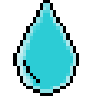<br><b>START</b></a></td>
<td align="center"><a href="#-how-to-play">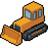<br><b>HOW TO PLAY</b></a></td>
<td align="center"><a href="#-weather-changes-everything">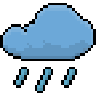<br><b>WEATHER</b></a></td>
<td align="center"><a href="#-your-toolkit">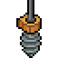<br><b>TOOLKIT</b></a></td>
<td align="center"><a href="#-high-score"><br><b>SCORE</b></a></td>
<td align="center"><a href="#-run-the-game"><br><b>PLAY IT</b></a></td>
</tr>
</table>

<br><br>

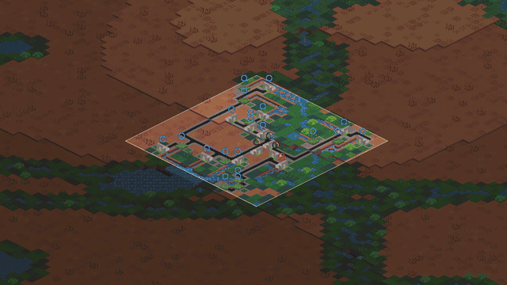

<sub><i>Observe → Dig → the water finds its own way.</i></sub>

</div>

---

## 🎮 Press Start

> **The city grows by itself. The water does not.**

Every day new houses and farms pop up, always a little farther from the river. You are the city's **canal planner**: dig channels, reshape the land so water can run downhill, and set up facilities before the weather turns. Keep the city alive for **45 days**, collect stars, and don't let more than **8 buildings** dry out or drown.

What makes it tick: **the water is a simulation, not an animation.** Droughts, floods and currents are never scripted. They emerge from a depth-based water model that runs 20 times per second.

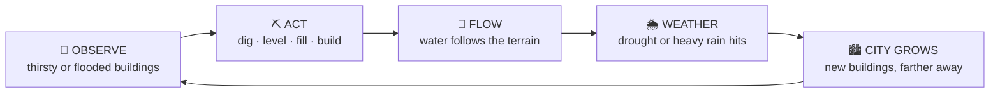

---

## 🕹 How to Play

<table>
<tr>
<td width="50%" valign="top">

### 🎯 Mission

- 1 day = **30 seconds**, the game lasts **45 days**
- Water every building through a canal or water source on **one of its 4 sides**
- That water must sit **at the same height or higher**: water never climbs on its own
- The land expands on days **10, 19, 28 and 37**

</td>
<td width="50%" valign="top">

### 💀 Game Over if…

- More than **8 buildings** are destroyed, or
- You end day 45 with fewer than **3,500 points**

A building is destroyed when its water reserve runs out, or when it stays flooded for **6 seconds**.

</td>
</tr>
</table>

### ⌨️ Controls

| Keys | Action |
|:---|:---|
| <kbd>1</kbd> <kbd>2</kbd> <kbd>3</kbd> | **Dig** · **Level** · **Fill** |
| <kbd>4</kbd> <kbd>5</kbd> <kbd>6</kbd> <kbd>7</kbd> | **Bridge** · **Drill Well** · **Spillway** · **Water Wheel** |
| <kbd>Left drag</kbd> | Use a tool along a path: straight line with one turn, previewed in 🟩 green / ⬜ white / 🟥 red before anything is spent |
| <kbd>Right drag</kbd> (Level) | Raise the ground instead of lowering it |
| <kbd>Esc</kbd> | Cancel the drag · open the pause menu |
| <kbd>Wheel</kbd> · <kbd>W</kbd><kbd>A</kbd><kbd>S</kbd><kbd>D</kbd> · <kbd>Middle drag</kbd> | Zoom · pan the camera |
| <kbd>Space</kbd> | Pause / resume |
| <kbd>H</kbd> | Hide / show the UI |
| <kbd>F</kbd> | Speed 1x → 2x → 5x (**Survey Mode only**) |

<details>
<summary><b>🏘️ LEVEL 1: The City Grows</b> (click to open)</summary>

<br>

| | 🏠 House | 🌾 Farm |
|:---|:---:|:---:|
| Water reserve | 40 | 28 |
| Empty after (no water) | 40 s | 28 s |
| At risk after | ~24 s | ~17 s |

- Starts with **2 buildings**. New ones arrive at **0.6 → 1.2 per day** (about 40 in total, 35% farms).
- They spawn **3 → 12 tiles away from water**, at least 3 tiles apart, so your canals keep getting longer.
- Each building is connected to the road network automatically. **Roads can't be dug**: use a Bridge.
- A watered building refills **4× faster** than it drains. The ring above it tells the story: 🔵 fine · 🟠 at risk · 🔴 critical.

</details>

<details>
<summary><b>⛏️ LEVEL 2: Shape the Land</b></summary>

<br>

| Tool | What it does | Daily budget |
|:---|:---|:---:|
|  **Dig** | Turns ground into a canal (bed 0.5 lower) | 15 |
| 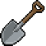 **Level** | Lowers (left) or raises (right) the ground by 1 step, heights 0–3 | 15 |
| 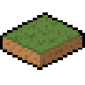 **Fill** | Closes a canal, or removes a facility for free and returns it to your stock | 10 |

Budgets reset every morning. Leftovers don't carry over, so plan each day.

</details>

<details>
<summary><b>🌊 LEVEL 3: Water Is Real</b></summary>

<br>

```text
surface = bed + depth          water moves toward the lower surface
flow    = height difference × 0.2   per step, 20 steps per second
canal   = a 0.5-deep trench    overflows only when it fills past the rim
```

Everything else **emerges** from those rules:

| You see… | because… |
|:---|:---|
| Water won't go uphill | it only moves to lower surfaces |
| Long canals get shallow at the end | every tile evaporates a little (0.01/s) |
| Cut-off canals dry up | nothing refills them |
| Rain causes floods | sources rise past their rim and spill onto lower ground |
| Floods don't spread forever | dry land soaks up 0.08/s |
| The map turns brown in a drought | ground near wet tiles is green, everything else dries out |

The water animation reads straight from the simulation: calm water stays calm, flowing water shows its real direction, and eddies form at bends.

</details>

<details>
<summary><b>⚔️ BOSS LEVEL: Two Choices, One Drought</b></summary>

<br>

Five houses are thirsty, a drought is coming, and you have **one Drill Well**. Dig one long canal from a small lake, or drill a permanent source right next to the houses?

<table>
<tr>
<td align="center" width="50%">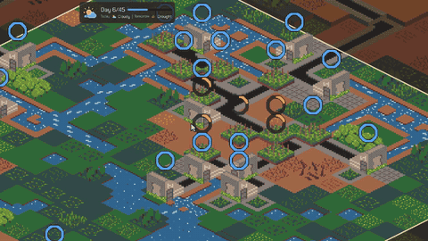<br><b>A · Long canal</b><br>The lake shrinks, the canal dries out<br><b>0 / 5 saved</b></td>
<td align="center" width="50%"><br><b>B · Drill Well</b><br>Drought can't touch groundwater<br><b>3 / 5 saved</b></td>
</tr>
</table>

There is no single right answer. It depends on the lake size, the forecast and your stock.

</details>

---

## 🌦 Weather Changes Everything

<table>
<tr>
<td align="center" width="33%">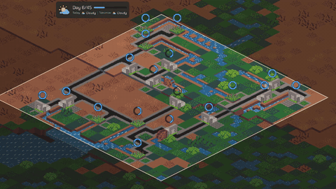<br><br><b>SUNNY</b><br><sub>Sources at normal level</sub></td>
<td align="center" width="33%">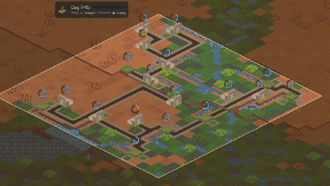<br>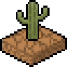<br><b>DROUGHT</b><br><sub>Sources shrink over 20 s</sub></td>
<td align="center" width="33%">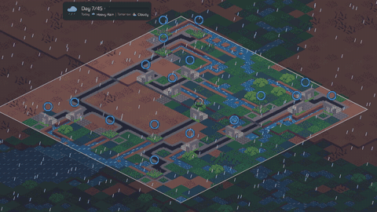<br><br><b>HEAVY RAIN</b><br><sub>Sources overflow, floods</sub></td>
</tr>
</table>

Weather never edits tiles directly. It only changes how full the **natural water sources** want to be, and the simulation does the rest.

- **Days 1–3 are always sunny**, so you can learn to dig.
- Drought chance rises **15% → 35%**, heavy rain **12% → 22%** toward day 45.
- Each drought hits harder: **−30%** the first time, **+5%** every time after, up to **−80%**. Small lakes (under 15 tiles) shrink **1.5×** faster.
- The HUD shows **today and tomorrow**. Read the forecast, prepare a day early.
- Every run gets a random **seed (1–999,999)** that sets the play area on the 250×250 map and the 45-day weather schedule.

---

## 🧰 Your Toolkit

<table>
<tr>
<td align="center" width="25%"><br><b>DRILL WELL</b><br><kbd>5</kbd></td>
<td align="center" width="25%">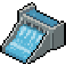<br><b>SPILLWAY</b><br><kbd>6</kbd></td>
<td align="center" width="25%"><br><b>WATER WHEEL</b><br><kbd>7</kbd></td>
<td align="center" width="25%">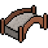<br><b>BRIDGE</b><br><kbd>4</kbd></td>
</tr>
<tr>
<td valign="top"><sub>Permanent groundwater source that pushes water into nearby canals. <b>Immune to drought.</b></sub></td>
<td valign="top"><sub>A weir that holds 0.3 of water and releases only the excess. Keeps its connected lake from <b>flooding in the rain</b>.</sub></td>
<td valign="top"><sub>Pumps water <b>one level uphill</b> into a canal. Spins with the flow for up to 0.25 pts/s.</sub></td>
<td valign="top"><sub>Turns a straight road tile into a canal crossing. The road stays connected. <b>+1 pt/day</b> if water flows under it.</sub></td>
</tr>
<tr>
<td align="center"><sub>⏱ +1 every 3 days</sub></td>
<td align="center"><sub>⏱ +1 every 5 days</sub></td>
<td align="center"><sub>⏱ +1 every 3 days</sub></td>
<td align="center"><sub>⏱ +1 every 2 days</sub></td>
</tr>
</table>

You start with one of each. Placed something in the wrong spot? **Fill** it to get it back for free.

---

## ⭐ High Score

| Source | Points |
|:---|:---|
| 🏠 Each watered building | **0.2 / s** (canal water only, rain doesn't count) |
| 🌙 End-of-day bonus | **4 ×** buildings watered for at least half the day |
| ⚙️ Spinning Water Wheel | up to **0.25 / s** |
| 🌉 Bridge with water under it | **1** per day |

<div align="center">

| ⭐ | ⭐⭐ | ⭐⭐⭐ |
|:---:|:---:|:---:|
| **3,500** | **5,000** | **8,500** |

<sub>One building watered for a whole day ≈ 10 points. The game keeps going after the first star, so chase the third.</sub>

</div>

---

## 🏆 Playtest Achievements

Real players, tested with the built-in Survey Mode:

| | |
|:---|:---|
| 🏁 **4 / 4** players won and survived all 45 days | 📈 Average score **8,008** points |
| ⭐ Average rating **4.5 / 5** (5.0 for clear goals and visuals & audio) | 🧠 **4 / 4** answered every mechanic question correctly |
| 💧 Water-management understanding **3.5 → 5.0** | 🏚️ Only **3** of the 8 allowed buildings lost on average |

<details>
<summary><b>📋 Survey Mode (for playtest hosts)</b></summary>

<br>

1. Main menu → **MODE SURVEI** (bottom right) → the player fills in a short profile.
2. Optional tutorial, then **Mulai Main**. Players may play several runs; only finished runs (win or lose) count.
3. Press <kbd>F</kbd> or the ⏩ buttons to play at **2x or 5x** to speed up long sessions.
4. After at least one finished run, **Isi Survei** opens the questionnaire: ratings, difficulty, NPS, 3 mechanic questions and free feedback.

Data is saved to `C:/COMPE/MAGE 12/FINAL/Survey` (override with the `WATERWAYS_SURVEY_DIR` environment variable). If that folder can't be created, the game falls back to a `Survey` folder next to the `.exe` or `user://Survey`:

- `survei.csv`: one row per player
- `percobaan.csv`: one row per finished run
- one folder per player with the profile, a summary, automatic screenshots and the session log

</details>

---

## 🚀 Run the Game

```bash
git clone https://github.com/RXhy/isometric-waterways.git
```

1. Install **[Godot 4.6](https://godotengine.org/download)** (standard build, not .NET).
2. Open `project.godot` in Godot (Import) and wait for the assets to import.
3. Press <kbd>F5</kbd>. The splash screen leads into the main menu.

The game runs at 1920×1080 fullscreen with a 640×360 pixel-art viewport.

<details>
<summary><b>🔧 Tuning without code</b></summary>

<br>

Gameplay numbers are exposed in the Inspector (the `world.tscn` root plus its Score, Weather and Facilities nodes): day length, number of days, tool budgets, weather chances and drought severity, star thresholds, damage quota, facility stock and more. Set `map_seed` to replay the same area and weather.

</details>

<details>
<summary><b>🗂️ Project structure</b></summary>

<br>

| Path | Contents |
|:---|:---|
| `world.gd`, `world.tscn` | Map, camera, tools, drag preview, land expansion |
| `water_sim.gd` | Water flow, evaporation, wells, spillways, water wheels, tile visuals |
| `weather_manager.gd` | Weather schedule, drought ramp, rain surge, forecast |
| `building_manager.gd`, `building.gd` | Spawning, water reserve, threat and destruction |
| `road_manager.gd`, `facility_manager.gd` | Roads and bridges, facility stock and placement |
| `score_manager.gd` | Points, daily bonus, stars |
| `balance_log.gd` | Automatic playtest logging (`playtest_logs/`) |
| `survey/` | Survey Mode: player profile, questionnaire, CSV export |
| `showcase/` | Scripted scenes used to record the trailer clips |
| `ui/` | HUD, menus, splash, loading, tutorial, settings |
| `audio/`, `assets/audio/` | Audio manager and sound files |
| `docs/` | Design docs: [`mechanic.md`](docs/mechanic.md), `art-pipeline.md`, `audio.md`, `ASSET_LIST.md` |
| `pitching/` | Final pitch deck and [`gameconcept.md`](pitching/gameconcept.md), the full rules with every number |

</details>

---

<div align="center">


Made by team **Ayam Renang** for **MAGE 12** · Institut Teknologi Sepuluh Nopember

<sub>Theme: <i>Long Life Legacy: Empowering Smart Cities for a Sustainable Urban Future</i> · Sub-theme: <b>Smart Technology Infrastructure</b></sub>

<sub>Built with <a href="https://godotengine.org">Godot</a> · UI font Chakra Petch (SIL Open Font License)</sub>

</div>
