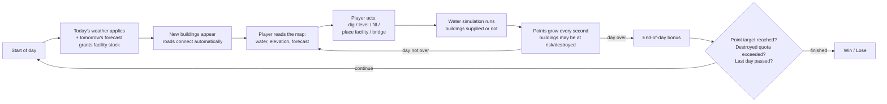
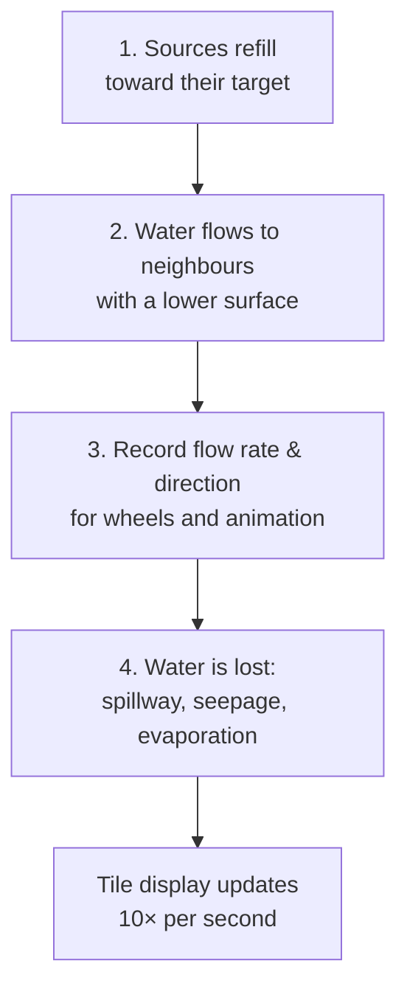

# WATERWAYS — Game Mechanics

This document explains the **gameplay flow (core loop)** and the **water system** of WATERWAYS as implemented in the current code, so the whole team (programmers and artists) shares the same understanding.

- All numbers below are **default values**. They can be changed in the **Inspector** without touching code. The "Set in" column names the node and property, and all of them are in `world.tscn` unless stated otherwise.
- Some Inspector group names are still Indonesian in the code (for example "Kamera", "Lahan & ekspansi", "Tileset air & jalan", "Animasi jalan", "Tampilan arus", "Jadwal otomatis"). They are quoted as-is here, with the English meaning in parentheses.
- When the code changes, this document must be updated too.

---

## 1. Summary

WATERWAYS is an isometric puzzle-strategy game. The player acts as a water-channel planner. The town grows on its own: new buildings appear every day. The player's job is to **bring water** from natural sources to the buildings by digging canals, adjusting ground height and placing facilities, while coping with **drought** and **heavy rain**.

- A game lasts **45 days**. At the end of day 45 the points are graded into **stars**: ≥ 3500 = 1 star (win), ≥ 5000 = 2 stars, ≥ 8500 = 3 stars.
- **Lose:** destroyed buildings **exceed the quota** (default **8**), or day 45 ends with fewer than 3500 points.

---

## 2. Core loop



### 2.1 Day cycle

| Rule | Default | Set in |
|---|---|---|
| Length of one day | 30 seconds | Node2D → `day_length` |
| Number of days | 45 | Node2D → `target_days` |
| Speed | Pause / normal (button at the top right, Space = pause). There is no 2× speed. | — |
| Zoom | Mouse wheel (toward the cursor), 0.75× – 2.5× | Node2D → group **"Kamera"** (Camera): `zoom_out_limit`, `zoom_in_limit`, `zoom_step`, `zoom_smooth` |
| Camera pan | Drag with the middle mouse button, WASD / arrow keys, or trackpad | Node2D → `pan_speed` |

What happens at the **start of every day**, in order:
1. The previous day's end-of-day bonus is calculated (see §6).
2. The shovel allowance resets (§4.1) and the bridge stock grows.
3. Today's weather applies (§5.5). **Tomorrow's weather forecast** decides the extra facility stock (§4.2).
4. New buildings appear (§3).

### 2.2 Play area
- The big map is 250×250 cells and is **made in the Godot editor** (TileMapLayer `World`), not generated at runtime.
- Each game randomly picks a **25×25 core area** that is guaranteed to contain a water source. The camera is set so that area fits the screen.
- The centre of the play area is chosen randomly (containing water, far from the map edge) so the camera always puts it in the **middle of the screen**. Set Node2D → `area_center` to lock a specific position.
- **Every cell visible at full zoom-out** is also simulated (water flows there). The camera cannot leave that frame. The smaller `zoom_out_limit` is, the larger the area (and the heavier the simulation).
- The **active land** is an **isometric diamond** in the middle of the screen, following the map grid (cream outline; outside the land is darkened). Tools and new buildings work only on the active land. The land **expands 4 times** (days 10, 19, 28, 37): its radius grows from what fits the starting screen up to what fits the zoom-out frame; the camera adjusts with it and the message "New land unlocked!" appears.
- Set in Node2D, group **"Lahan & ekspansi"** (Land & expansion): `diamond_ui_respect` (0.5 = the top/bottom tips may slightly enter the UI area; 1 = never touch the UI), `expansion_steps` (4), `expand_every_days` (9), `ui_margin_top/bottom/side`, `locked_shade`, `border_color`.
- The **H key** (or "Hide UI" in the pause menu) hides all UI; press H again to show it.
- Randomness uses a **seed**: Node2D → `map_seed` (0 = random). The seed that was used is always written to the playtest log, so the same map can be replayed.

---

## 3. The town: buildings & roads

### 3.1 Building spawning
| Rule | Default | Set in |
|---|---|---|
| Buildings on day 1 | 2 | Buildings → `buildings_first_day` |
| New-building rate | 0.6/day (start) → 1.2/day (day 45), fractions accumulate; ~40 buildings in total | Buildings → `spawn_rate_start`, `spawn_rate_end` |
| Spawn area grows | 25×25 core → the whole zoom-out frame | Buildings → `spawn_area_growth` (0 = does not grow) |
| Chance of being a Farm (the rest are Houses) | 35% | Buildings → `farm_chance` |
| Minimum distance between buildings | 3 cells | Buildings → `min_building_spacing` |
| Distance to the nearest water | min 3, max 6 (start) → 12 (end) cells | Buildings → `min_water_distance`, `max_water_distance_start/_end` |

This means buildings deliberately appear **somewhat far from water**. The player *must* dig canals, and the longer the game runs, the longer the canals have to be.

### 3.2 Building water needs
Every building has a **water reserve**, shown as a ring above it.

| | House | Farm |
|---|---|---|
| Maximum water reserve | 40 | 28 |

Set in `building.gd` → `TYPE_DATA`.

- **Supplied** (see the rule below): the reserve fills **4× faster** than it drains.
- **Not supplied**: the reserve drops by 1 per second.
- Reserve below 40%: **At risk** status (orange/red ring, blinking exclamation mark).
- Reserve empty: **Destroyed** (becomes ruins).
- **Flood**: if the building's cell stays under water for ≥ 6 seconds, the building is also destroyed (Building → `flood_limit`).

**The "supplied" rule:** a building is supplied when one of the **4 cells on its sides** (directly in front or beside it, not diagonal; `NEIGHBORS_SIDE` in `is_cell_supplied`, switchable to 8 directions with the `supply_diagonals` export on the World node) is a canal or water source that **currently has water** and whose **elevation is equal to or higher** than the building (water cannot climb). During **heavy rain**, all buildings count as supplied.

### 3.3 Water & road tileset (tilesset_water_road.png)
- `assets/Tiles/tilesset_water_road.png` (32 px grid) is installed automatically when the game starts (Node2D group **"Tileset air & jalan"**, `use_tileset_v2`).
- **Natural water** (rows 0–8): 9 lake-edge shapes chosen by which sides border land. The lip colour follows the land next to it (dry / grass / dark grass). Each group of 3 rows = dry, shallow, full (from water depth; the "full" limit is `v2_full_depth`).
- **Dug canal** (rows 10–15): 11 junction shapes (2 straight, 4 bends, 4 T-junctions, crossroads) chosen from the canal/water neighbours on the 4 sides; a dead end uses a straight tile. Brick (10–12) or stone (13–15) via `canal_style`.
- **Road** (row 17): the same 11 junction shapes; a road end connects to the building next to it.
- Digging a canal (click/drag): the shovel use is deducted immediately, then the canal appears cell by cell following the drag order with a drop animation (`dig_step_delay`, `dig_drop_time`, `dig_drop_height`).
- The old flow animation and edge foam are not used while this tileset is active.

### 3.4 Roads
- Every new building is automatically connected to other buildings by road (shortest route, preferring existing roads).
- Roads are **built cell by cell** from the old road network toward the new building, with a drop animation as each cell lands (Terra Nil style). Set in Roads, group **"Animasi jalan"** (Road animation): `road_start_delay` (0.6 s), `road_step_delay` (0.08 s/cell), `road_drop_time`, `road_drop_height`. A cell still waiting already counts as road (it cannot be dug or built on).
- **Roads cut across canals**: ground under a road cannot be dug. To let water cross a road, place a **Bridge** (§4.2).

---

## 4. Player actions

The toolbar at the bottom left of the screen holds 7 tools (keys 1–7), then the Layers button and the menu button (gear). The number on a card's corner shows the remaining stock.

### 4.1 Shovel tools: Dig, Level, Fill
All three share the **daily shovel allowance**.

| Rule | Default | Set in |
|---|---|---|
| Shovel allowance per day | 15 actions | Node2D → `shovel_per_day` |
| Unused allowance | does **not** carry over to tomorrow | — |

| Tool | Left click | Right click | Cost |
|---|---|---|---|
| **Dig** (1) | Ground → **canal** (floor drops 0.5) | — | 1 shovel |
| **Level** (2) | Lower the elevation by 1 level | Raise it by 1 level | 1 shovel |
| **Fill** (3) | Close a dug canal → ground again | — | 1 shovel |
| Fill on a facility/bridge | Remove it, **stock is returned** | — | free |

**Drag like Mini Motorways:** press on a cell, drag, then release.
- The path is always **neat along the grid**: straight along one isometric axis, then a single turn (an L shape) following the direction of the first drag.
- While dragging there is a preview: **green** = will be done, **white** = skipped because it already matches, **red** = not possible or not enough shovels.
- The tooltip shows the number of cells and the shovels that will be used.
- The action only runs when the mouse button is **released**. Esc or pressing another mouse button cancels the drag.
- For Level, drag with the left click to lower and the right click to raise. Every cell on the path changes by ±1 level.
- Maximum path length is 40 cells (Node2D → `max_drag_length`).

Elevation has 4 levels (0–3): Shoreline, Low plain, Mid plain, High plain. Water only flows to lower surfaces, so Level is used to "make a slope" so water can reach a building.

### 4.2 Facilities & bridge
| Tool | Function | Placement requirement | Starting stock | Extra stock |
|---|---|---|---|---|
| **Bridge** (4) | Turns a road cell into a canal that water can flow through (the road stays connected) | On a road cell | 2 | +1 every new day |
| **Drill Well** (5) | Permanent groundwater source, **unaffected by drought** | On ground | 1 | +1 if tomorrow is **Drought** |
| **Spillway** (6) | A weir in the canal: holds water at 0.3 (`spillway_crest`), only the excess flows downstream. A water body connected to a spillway **does not overflow** during rain | On a **straight** canal/river (↖↘ or ↗↙ link) | 0 | +1 if tomorrow is **Rain** |
| **Water Wheel** (7) | **Pump**: lifts water from its cell into the canal/river next to it that is **1 level higher**, so flow can climb to higher ground. A small point bonus from the current (§6) | On a canal or river/lake | 2 | +1 if tomorrow is **Sunny** |

Set the stock in Facilities → `start_stock` and `stock_per_forecast` (order: Drill Well, Dam, Spillway, Water Wheel; the Dam was removed from the toolbar, leave its value at 0). For the bridge, set it in Roads → `bridges_start`, `bridges_per_day`.

**The heart of the strategy:** facility stock is granted **based on tomorrow's forecast**. The player gets the right tool a day before the weather arrives, and must place it in time.

### 4.3 Information for the player
- The **tile cursor** is green (allowed), red (not allowed) or white (info only).
- The **tooltip** shows the cell type, elevation, water depth, building status, wheel rotation, and a **preview of the selected tool's action** with the reason if it is not possible.
- The **Layers button** (icon to the right of the toolbar) cycles through: Off → **Elevation** (colour per elevation) → **Water Depth**.

### 4.4 In-game menu
The menu opens with the **gear** button at the end of the toolbar (bottom left) or the **Esc** key. While the menu is open, the game is paused.

The menu contains: **Resume**, **Restart**, **Settings**, **Main Menu**.

Settings contains:
- master, music and sound-effect volume
- fullscreen
- cell info tooltip

Settings are saved automatically in `user://settings.cfg`. The `Music` and `SFX` audio buses are in `default_bus_layout.tres`. All audio is played by the `Audio` autoload (`scenes/audio_manager.tscn`, full list in `AUDIO.md`).

The pause menu also has a **Tutorial** button (7 pages, the same as the tutorial in the main menu).

---

## 5. The water system

The water system is a **depth-based simulation** inspired by Timberborn. Drought, flood and current are **not scripted**. They all emerge from simple flow rules. The code is in `water_sim.gd`, the weather in `weather_manager.gd`.

### 5.1 Basic concepts

```
Height unit: 1.0 = one elevation level

floor(cell)    = elevation          (land)
               = elevation − 0.5    (dug canal, river/lake bed, drill well)
surface(cell)  = floor + water depth
rim(canal)     = elevation          (canal lip: water only spills onto land once it goes above this)

wet    = depth ≥ 0.06
flood  = land cell with depth ≥ 0.1
```

So a canal is a "ditch" 0.5 deep. Water fills that ditch first, and only **overflows** onto the surrounding land when its surface rises above the canal lip.

### 5.2 One simulation step (20× per second)



1. **Sources refill.** Every natural water source cell moves toward its **target** (normally 0.5, set by the weather). Drill wells always move toward 0.5.
2. **Flow.** Every wet cell sends its water to the 4 edge neighbours with a lower surface. Flow amount = surface difference × 0.2. A canal does not spill onto land unless its surface is already past the rim. Dam cells are skipped (watertight). All transfers are computed first, then applied together.
3. **Flow rate & direction.** The water leaving each cell is averaged. The result is used for the wheel rotation (§6) and the current animation direction (§5.6).
4. **Water is lost:**
   - (A spillway does not discard water; it holds 0.3 and passes the excess on, see step 2.)
   - Water on **land** seeps away at 0.08 per second, which limits how far a flood spreads.
   - **Dug canals** evaporate 0.02 per second. A canal cut off from its source slowly dries out.

| Value | Default | Set in |
|---|---|---|
| Steps per second | 20 | Water → `tick_rate` |
| Flow speed | 0.2 | Water → `flow_k` (max 0.25) |
| Canal depth | 0.5 | Water → `channel_depth` |
| Source refill speed | 1.5 /second | Water → `source_rate` |
| "Wet" threshold | 0.06 | Water → `wet_threshold` |
| "Flood" threshold | 0.1 | Water → `flood_threshold` |
| Canal evaporation | 0.02 /second | Water → `canal_evaporation` |
| Land seepage | 0.08 /second | Water → `land_absorb` |
| Spillway holding height | 0.3 | Water → `spillway_crest` |

### 5.3 Water bodies
When the game starts, adjacent natural-water source cells are grouped into a **water body**: one river or lake counts as a single unit. The weather sets the target of each water body. Its size (number of cells) decides whether that body counts as "small" during a drought.

### 5.4 Effect on how the land looks
Every 1 second, land is regrouped by its distance to water that currently has water:
- ≤ 2 cells from water: **green ground** (rows 1–2 of `terrain_tiles.png`)
- A building near water and its surroundings: **yard** (row 3)
- Anything else: **dry ground** (row 0)

This means a drought visually turns the map brown, and digging a canal turns its surroundings green.

### 5.5 Weather

Weather **does not change cells directly**. It only changes the **source targets**, then drought and flood emerge from the simulation.

**Automatic schedule** (Weather → `auto_schedule` = on): generated from the map seed, so the same seed = the same weather.
- Days 1–3 are always Sunny (`calm_days`).
- The chance of Drought rises 15% → 35% and of heavy Rain 12% → 22% from start to end (group **"Jadwal otomatis"**, Automatic schedule).
- The same extreme weather can occur at most 2 days in a row (`max_streak`).
- Turn off `auto_schedule` to use the manual `schedule` list.

The bottom bar shows a 3-day forecast. Its tooltip names the drought level.

**Sunny:** normal source target (0.5).

**Drought:**
- Sources shrink **gradually** over the first 20 seconds of the day, not dry at once.
- **It gets worse with every later drought:**

  | Drought # | Large source drops | Small source (< 15 cells) drops |
  |---|---|---|
  | 1 | 30% | 45% |
  | 2 | 50% | 75% |
  | 3 | 70% | 100% (dry) |

- The formula is: `target = 0.5 × (1 − severity × progress)`, with `severity = min(max, start + step × (n − 1))`, multiplied by 1.5 for small water bodies.
- Drill wells are unaffected.
- Set in Weather, group **"Drought"**: `drought_severity_start` (0.3), `drought_severity_step` (0.05), `drought_severity_max` (0.8), `drought_ramp_time` (20), `drought_small_body` (15), `drought_small_mult` (1.5).

**Heavy rain:**
- The source target rises by **+0.35** (to 0.85, above the canal lip), so sources **overflow** onto lower land. This is the flood.
- Water bodies with a **Spillway** are not raised.
- All buildings count as supplied (none go dry), but buildings can **drown** if they are under water for ≥ 6 seconds.
- Set in Weather → `rain_surge`.

### 5.6 Water appearance (Terra Nil-style current animation)
Every wet cell picks an animated tile from `assets/water/water_flow.png` based on the simulation:

| Condition | Tile |
|---|---|
| Net flow < 0.012 | **Still** (lake/puddle) |
| Net flow 0.012 – 0.06 | **Slow current** along the flow (4 directions) |
| Net flow ≥ 0.06 | **Fast current** along the flow (4 directions) |
| Depth < 0.18 (not a natural source) | **Shallow / water front**, foamy, visible while a new canal is filling |

Water sides that border land get **edge foam** (layer `World/WaterEdge`, `water_edge.png`).

These thresholds are set in Water, group "Tampilan arus" (Flow display): `still_flow`, `fast_flow`, `shallow_depth`.

### 5.7 Short pseudocode

```
// ===== Start of game =====
group adjacent WATER cells into "water bodies" (flood fill)
every water-body cell: depth = 0.5, target = 0.5

// ===== Start of day =====
weather = schedule[day]
facility stock += according to TOMORROW's forecast
compute_source_targets()

// ===== Every step (20x per second) =====
IF drought: compute_source_targets()          // target drops gradually

// 1. Sources refill toward the target
FOR each water-body cell c: depth[c] += (target[body(c)] - depth[c]) * 1.5 * dt
FOR each drill-well cell c: depth[c] += (0.5 - depth[c]) * 1.5 * dt

// 2. Flow: computed first, applied together
FOR each wet, non-dam cell c:
    s = floor(c) + depth[c]
    FOR each edge neighbour n (not a dam):
        level = floor(n) + depth[n]
        IF c is canal AND n is land: level = max(level, elevation(c))   // canal rim
        IF s > level: planned_flow(c -> n) = (s - level) * 0.2
    scale = min(1, depth[c] / total_planned)                      // cannot move more than it has
    move planned_flow * scale; record flow rate & direction leaving c
apply all transfers

// 3. Water is lost
FOR each wet cell c:
    IF land:         depth[c] -= 0.08 * dt   // flood seepage
    IF dug canal:    depth[c] -= 0.02 * dt   // evaporation

// ===== Source target per water body =====
compute_source_targets():
    FOR each water body b:
        SUNNY:   target = 0.5
        RAIN:    target = 0.5 if b has a spillway, otherwise 0.5 + 0.35   // overflows
        DROUGHT: sev = min(0.8, 0.3 + 0.2 * (drought_number - 1))
                 IF size(b) < 15: sev = min(1, sev * 1.5)
                 target = 0.5 * (1 - sev * min(1, seconds_since_day_start / 20))

// ===== Used by other systems =====
wet(c)       = depth[c] >= 0.06
flood(c)     = c is land AND depth[c] >= 0.1
supplied(b)  = an edge neighbour n (4 directions) is canal/source, wet(n), elevation(n) >= elevation(b)
               OR weather is RAIN
wheel_rotation(c) = clamp(avg_flow_rate(c) / 0.1, 0, 1)
water_tile(c) = SHALLOW if depth < 0.18 (not a natural source)
                STILL   if net_flow < 0.012
                SLOW/FAST CURRENT toward the dominant flow direction (fast if >= 0.06)
```

---

## 6. Points, winning & losing

| Source of points | Amount | Set in |
|---|---|---|
| Supplied building | 0.2 points/second per building | Score → `supplied_per_second` |
| Water Wheel | up to 0.25 points/second per wheel (× rotation 0–100%) | Facilities → `kincir_points_per_second` |
| End-of-day bonus | 4 × buildings **supplied by the player for at least half of that day** (rain does not count) | Score → `day_bonus_per_building`, `day_bonus_min_supplied` (0.5) |
| Bridge | 1 × each bridge **that water passes through**, at the end of every day | Score → `bridge_bonus_per_day` |

Rule of thumb: one building supplied for a full day = 0.2 × 30 + 4 = **10 points**.

**Water Wheel as a pump:** every second the wheel moves water from its cell to the edge neighbours (↖ ↗ ↙ ↘) that are a canal/river, 1 level higher (Facilities → `kincir_max_lift`), and not yet full. The rate is 0.8 depth/second, shared equally among all target cells (Facilities → `kincir_lift_rate`). The pump is one-way: water that has been lifted does not flow back to the wheel cell. The wheel cell needs water (connected to a river/canal with water). How to use it: dig a canal on the higher ground until it touches the side of the water cell below, then place the wheel on that water cell.

**Wheel points:** rotation = water flow leaving the wheel cell ÷ 0.1 (Facilities → `kincir_full_flux`), clamped to 0–100%. Water only flows when something "pulls" it downstream: evaporation along a long canal, a spillway, flood seepage, or new water filling a canal. So a wheel at the **head of a long canal** spins faster. A wheel in a calm lake stays still.

| Condition | Default | Set in |
|---|---|---|
| **Win** | Day 45 finishes with ≥ 3500 points (1 star) | Score → `target_points` |
| 2 / 3 stars | ≥ 5000 / ≥ 8500 | Score → `star2_points`, `star3_points` |
| End when 1 star is reached | off (keep playing until day 45) | Score → `end_on_target` |
| **Lose** (quota) | Destroyed buildings > 8 | Node2D → `damage_quota` |
| **Lose** (time) | Day 45 finishes with < 3500 points | Node2D → `target_days` |

The points bar in the top-right panel shows progress toward the **next star**.

Click the points bar in the top-right panel to see the points breakdown per source.

---

## 7. Balancing tools

### 7.1 Automatic playtest log
Every time the game is played, these are created automatically:
- `playtest_logs/sesi_<date_time>_<tester>.csv`, containing:
  - one row per end of day (points per source, buildings alive/at risk/destroyed, shovels, stock, facilities, percentage of canals with water)
  - one row for every destroyed building, with its cause
  - one row with the final result
- `playtest_logs/ringkasan_<tester>.csv`, containing one row per session.

**Contents of the session log:**

| Part | Content |
|---|---|
| Header (`#`) | Session, tester, **build version** (`branch@commit`), seed, **param_id**, then `PARAM` rows listing **every balancing number** in effect |
| `AKHIR_HARI` (end of day) | Situation when the day ends: points per source, buildings, shovels, stock, facilities. Plus aggregates over that day: number of actions (dig, level down/up, fill, place/remove facility, bridge, drag), seconds buildings were at risk, number of buildings that were ever at risk, % of time buildings were supplied, widest flood (cells), worst % of dry sources, average wheel rotation, seconds paused / 2× / in menu, buildings that failed to spawn |
| `PERTAMA` (first) | First moments: the player's first action, first building at risk, first building destroyed, point target reached |
| `HANCUR` (destroyed) | Each destroyed building, with its cause (drought/flood) |
| `AKHIR` / `SURVEI` (end / survey) | Game result, then the answers to the end-screen survey |

**`ringkasan_<tester>.csv`** (summary) holds one row per session:
- version, param_id, seed, result
- time of the first moments
- total actions
- total time paused / 2× / in menu
- survey answers (tense & fair, 1–5)

Sessions with the same `param_id` used exactly the same balancing numbers, so they can be compared directly. If the summary format changes, the old file is automatically kept with a `_format_lama_…` suffix.

**End-screen survey:** after a win/loss, 2 questions appear with 1–5 buttons ("how tense" and "how fair"). The survey can be turned off in BalanceLog → `end_survey`.

Sessions that are **cut short because the game was closed** (X button, Stop button in the editor, or a crash) are **deleted automatically**, so the folder only holds finished sessions. This can be turned off in BalanceLog → `delete_unfinished`. Leaving through the menu (Restart / Main Menu) is still recorded as DITINGGALKAN (abandoned).

The tester name is taken from the Windows user name, or from BalanceLog → `tester_name`. When run from the editor, the log folder is inside the project. For an exported build, the folder is next to the .exe. The log folder can be opened directly in the file explorer.

### 7.2 Debug keys
Removed (F1–F4 no longer exist) to keep the competition build clean.

### 7.3 Balancing process
Record every number change in the team spreadsheet:
- tab **Log Balancing**: what was changed, why, and the result
- tab **Target Balancing**: the experience targets we want to reach

Change **one group of knobs per playtest round**, and use the **same seed** when comparing two versions.

---

## 8. File map

| File | Content |
|---|---|
| `world.gd` / `world.tscn` | Main scene: day cycle, player tools, tooltip, camera, play area |
| `water_sim.gd` | Water simulation, flow rate & direction, water tile display, land classes |
| `weather_manager.gd` | Weather schedule, gradual drought, rain |
| `facility_manager.gd` | Drill Well, Dam, Spillway, Water Wheel (placement rules, stock, wheel points) |
| `building_manager.gd` / `building.gd` | Building spawning, water reserve, destruction |
| `road_manager.gd` | Automatic roads & bridges |
| `score_manager.gd` | Points & target |
| `overlay.gd` | Info layer (elevation / water depth) |
| `balance_log.gd` | Automatic playtest log |
| `ui/hud.gd` | HUD: top left weather & day, top right points/buildings/destroyed/bridges + speed, bottom left toolbar, bottom right Water Flow, tooltip |
| `scenes/*.tscn` | Appearance of buildings, facilities, wheel, bridge, tool cards |
| `scenes/menu_map.tscn` | Diorama map used only as the main-menu background (edited directly in the editor) |
| `tools/build_menu_map.gd` | Script that first generated `menu_map.tscn` (running it again overwrites hand edits) |
| `ASSET_LIST.md` | List of assets the artists need |
