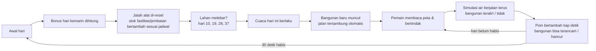
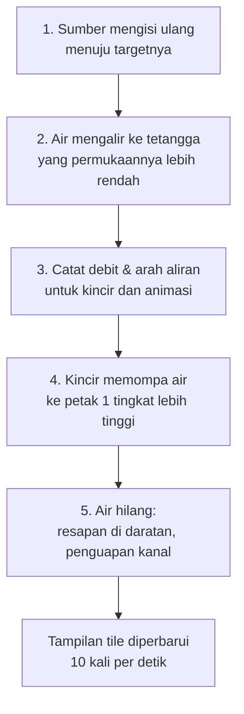

# WATERWAYS — Game Concept & Logic

Dokumen ini menjelaskan **cara kerja WATERWAYS dari dalam**: aturan, sistem, angka, dan alasan desainnya. Tujuannya supaya kamu paham keseluruhan game sebelum menyusun script pitching.

Semua angka diambil langsung dari **kode project yang sekarang** (`world.gd`, `water_sim.gd`, `weather_manager.gd`, `building.gd`, `building_manager.gd`, `facility_manager.gd`, `road_manager.gd`, `score_manager.gd`). Kalau ada angka yang beda dengan `docs/mechanic.md`, ikuti dokumen ini. Daftar perbedaannya ada di [bagian 12](#12-catatan-beda-dengan-dokumen-lama--slide).

---

## Daftar isi

1. [Ringkasan dalam 30 detik](#1-ringkasan-dalam-30-detik)
2. [Fantasi pemain & pilar desain](#2-fantasi-pemain--pilar-desain)
3. [Struktur permainan: hari, lahan, dan tujuan](#3-struktur-permainan-hari-lahan-dan-tujuan)
4. [Kota: bangunan & jalan](#4-kota-bangunan--jalan)
5. [Aksi pemain: Gali, Ratakan, Timbun](#5-aksi-pemain-gali-ratakan-timbun)
6. [Sistem air (jantung game)](#6-sistem-air-jantung-game)
7. [Cuaca](#7-cuaca)
8. [Fasilitas & jembatan](#8-fasilitas--jembatan)
9. [Poin, bintang, menang & kalah](#9-poin-bintang-menang--kalah)
10. [Contoh skenario dari awal sampai akhir](#10-contoh-skenario-dari-awal-sampai-akhir)
11. [Informasi yang dilihat pemain (UI)](#11-informasi-yang-dilihat-pemain-ui)
12. [Catatan: beda dengan dokumen lama & slide](#12-catatan-beda-dengan-dokumen-lama--slide)
13. [Glosarium](#13-glosarium)
14. [Lampiran: tabel semua angka penting](#14-lampiran-tabel-semua-angka-penting)

---

## 1. Ringkasan dalam 30 detik

**WATERWAYS** adalah game **puzzle-strategy isometrik** tentang mengelola distribusi air. Game ini dibuat dengan **Godot 4.6** dan **GDScript**.

- **Peranmu:** perencana saluran air sebuah kota kecil.
- **Kota tumbuh sendiri:** setiap hari muncul rumah dan ladang baru, sengaja agak jauh dari air.
- **Tugasmu:** mengalirkan air dari sumber alami (sungai/danau) ke bangunan dengan:
  - menggali kanal,
  - mengubah ketinggian tanah,
  - memasang fasilitas (Sumur Bor, Spillway, Kincir Air, Jembatan).
- **Tantangan:** cuaca. **Kemarau** membuat sumber menyusut. **Hujan lebat** membuat sumber meluap dan banjir.
- **Durasi:** 45 hari in-game, 1 hari = 30 detik (total ±22,5 menit).
- **Menang:** bertahan sampai hari 45 dengan minimal **3.500 poin**. Batas bintang: 1★ = 3.500, 2★ = 5.000, 3★ = 8.500.
- **Kalah:** lebih dari **8 bangunan hancur**, atau poin di akhir hari 45 belum mencapai 3.500.

Kalimat kuncinya: **air di WATERWAYS adalah simulasi, bukan animasi.** Kering, banjir, dan arus tidak di-script. Semuanya muncul sendiri dari aturan fisika sederhana.

---

## 2. Fantasi pemain & pilar desain

| Pilar | Artinya di game | Bukti di sistem |
|---|---|---|
| **Air itu nyata** | Air punya kedalaman, mengalir ke tempat yang lebih rendah, bisa meluap, meresap, dan menguap | `water_sim.gd`: simulasi kedalaman per petak, 20 langkah per detik |
| **Membaca, lalu bertindak** | Pemain melihat cuaca hari ini dan besok, lalu menyiapkan solusi | HUD prakiraan cuaca, peringatan bangunan terancam |
| **Sumber daya terbatas** | Setiap hari jatah alat terbatas dan tidak terbawa ke besok, stok fasilitas bertambah pelan | Jatah harian Gali 15, Ratakan 15, Timbun 10 |
| **Kota yang terus tumbuh** | Tekanan naik pelan: bangunan bertambah, makin jauh dari air, cuaca makin ekstrem | Laju spawn naik, jarak ke air naik, peluang cuaca ekstrem naik |
| **Tidak ada jawaban tunggal** | Satu masalah bisa diselesaikan dengan beberapa cara | Contoh di slide "Two Choices": gali kanal panjang atau pasang Sumur Bor |

Inspirasi yang bisa disebut ke juri:
- **Timberborn:** simulasi air berbasis kedalaman.
- **Mini Motorways:** kota tumbuh sendiri dan kontrol drag yang rapi.
- **Terra Nil:** animasi petak "jatuh" saat dibangun.

---

## 3. Struktur permainan: hari, lahan, dan tujuan

### 3.1 Siklus hari



Urutan kejadian **tepat di awal setiap hari** (dari `_check_new_day()` di `world.gd`):

1. **Bonus akhir hari kemarin** dihitung (lihat bagian 9).
2. **Jatah alat di-reset:** Gali 15, Ratakan 15, Timbun 10. Sisa kemarin hangus.
3. **Stok jembatan dan fasilitas** bertambah kalau hari itu jadwalnya (bagian 8).
4. **Lahan melebar** kalau hari itu hari ekspansi.
5. **Cuaca hari ini** diterapkan.
6. **Bangunan baru** muncul.

| Aturan | Nilai |
|---|---|
| Panjang 1 hari | 30 detik |
| Jumlah hari | 45 |
| Kontrol waktu | Pause / Play (tombol kanan atas atau **Spasi**). Tidak ada 2×. |

### 3.2 Peta & lahan bermain

- **Peta besar:** 250×250 petak, dibuat manual di editor Godot (TileMapLayer), bukan di-generate saat runtime.
- **Area simulasi:** setiap permainan memilih pusat secara **acak** berdasarkan **seed**. Pusatnya harus punya air (12 sampai 150 petak air di sekitarnya) dan cukup jauh dari tepi peta. Area simulasinya 25×25 petak di sekitar pusat itu.
- **Lahan aktif:** berbentuk **belah ketupat isometrik** di tengah layar. Alat dan bangunan baru hanya bisa dipakai di lahan aktif. Di luar lahan aktif, layar digelapkan.
- **Ekspansi lahan:** lahan melebar **4 kali**, pada hari **10, 19, 28, 37** (tiap 9 hari). Kamera ikut zoom out dan muncul pesan *"New land unlocked!"*. Artinya lebih banyak ruang, tapi juga lebih banyak bangunan yang harus dilayani.
- **Elevasi:** ada 4 tingkat, yaitu 0 *Shoreline*, 1 *Lowland*, 2 *Midland*, 3 *Highland*. Ketinggian ini yang menentukan ke mana air bisa mengalir.
- **Seed:** seed yang sama menghasilkan area, jadwal cuaca, dan pola bangunan yang sama. Ini dipakai untuk balancing dan bisa jadi poin "replayable & fair" saat pitching.

### 3.3 Tujuan

- **Utama:** bertahan 45 hari dan kumpulkan poin sebanyak-banyaknya.
- **Kalah lebih awal:** begitu bangunan hancur **melebihi 8** (bangunan ke-9 hancur), game langsung selesai.

---

## 4. Kota: bangunan & jalan

### 4.1 Kemunculan bangunan

| Aturan | Nilai | Artinya |
|---|---|---|
| Bangunan di hari 1 | 2 | Pemain langsung punya tugas |
| Laju bangunan baru | 0,6/hari (awal) naik ke 1,2/hari (hari 45) | Pecahannya dikumpulkan. Total ±40 bangunan dalam 45 hari |
| Jenis | 35% Ladang, 65% Rumah | |
| Jarak minimal antarbangunan | 3 petak | Kota tidak menumpuk |
| Jarak ke air terdekat | minimal 3, maksimal 6 petak di awal, naik ke 12 petak di akhir | **Bangunan sengaja muncul jauh dari air.** Pemain wajib menggali, dan kanalnya makin panjang seiring waktu |
| Lokasi | Hanya di lahan aktif yang sudah terbuka | |

### 4.2 Kebutuhan air bangunan

Setiap bangunan punya **cadangan air** yang terlihat sebagai **cincin** di atasnya.

| | Rumah | Ladang |
|---|---|---|
| Cadangan maksimal | 40 | 28 |
| Habis kalau tidak dialiri | 40 detik (±1⅓ hari) | 28 detik (<1 hari) |
| Mulai **terancam** (cadangan di bawah 40%) | setelah ±24 detik tanpa air | setelah ±17 detik tanpa air |

Aturan per detik (`building.gd`):

- **Teraliri:** cadangan bertambah **4 per detik**, jadi 4× lebih cepat dari berkurangnya. Dari kosong ke penuh hanya butuh ±7–10 detik.
- **Tidak teraliri:** cadangan berkurang **1 per detik**.
- **Status bangunan:**
  - **Hidup:** cincin biru.
  - **Terancam:** cadangan di bawah 40% **atau** sedang tergenang banjir. Cincin oranye, lalu merah kalau cadangan di bawah 20%. Tanda seru berkedip dan ada bunyi peringatan.
  - **Hancur:** cadangan habis **atau** tergenang banjir **≥ 6 detik**. Bangunan jadi reruntuhan dan dihitung ke kuota hancur.

Ladang lebih rakus dan lebih cepat terancam daripada rumah. Ini membuat pemain harus memprioritaskan.

### 4.3 Aturan "teraliri" (penting!)

Sebuah bangunan dianggap **teraliri** kalau **salah satu dari 4 petak di sisinya** memenuhi **tiga syarat sekaligus**. Yang dihitung hanya depan, belakang, kiri, dan kanan. Petak di sudut atau serong tidak dihitung.

1. Petak itu **kanal atau sumber air** (sungai, danau, sumur bor),
2. petak itu **sedang berair** (kedalaman ≥ 0,06),
3. **elevasi** petak itu **sama atau lebih tinggi** dari bangunan.

Syarat ketiga muncul karena **air tidak bisa naik sendiri**. Kanal yang lebih rendah dari bangunan tidak bisa mengalirinya.

**Pengecualian saat hujan lebat:** semua bangunan dianggap teraliri, jadi cadangannya tidak berkurang. Tapi **poin tetap hanya dihitung dari aliran kanal yang sungguhan** (lihat bagian 9).

### 4.4 Jalan

- Setiap bangunan baru otomatis **disambungkan dengan jalan** ke jaringan jalan atau bangunan terdekat. Rutenya dicari dengan pathfinding yang lebih memilih jalan yang sudah ada dan menghindari tanjakan.
- Jalan dibangun **petak demi petak** dengan animasi jatuh, seperti di Terra Nil.
- **Jalan tidak bisa digali.** Kalau kanal harus menyeberangi jalan, pemain memasang **Jembatan** (bagian 8).
- Arti desainnya: kota yang tumbuh "memotong" rencana kanal pemain, jadi pemain harus beradaptasi.

---

## 5. Aksi pemain: Gali, Ratakan, Timbun

Toolbar di kiri bawah berisi 7 alat (tombol **1–7**), lalu tombol **Layers** dan menu (gear).

### 5.1 Jatah harian (tidak terbawa ke besok)

| Alat | Tombol | Klik kiri | Klik kanan | Jatah/hari |
|---|---|---|---|---|
| **Gali** | 1 | Tanah jadi **kanal** (dasarnya turun 0,5) | — | 15 |
| **Ratakan** | 2 | **Turunkan** elevasi 1 tingkat | **Naikkan** elevasi 1 tingkat | 15 |
| **Timbun** | 3 | Tutup kanal galian jadi tanah lagi. Kalau dipakai di fasilitas atau jembatan, benda itu **dibongkar gratis** dan stoknya kembali | — | 10 |

Batasan:

- **Gali** hanya di tanah kosong, bukan di jalan, bangunan, atau fasilitas.
- **Ratakan** tidak bisa dipakai di sumber air alami, bangunan, jalan, atau fasilitas. Elevasinya dibatasi 0–3.

### 5.2 Kontrol drag (gaya Mini Motorways)

- **Tekan, seret, lalu lepas.** Jalurnya selalu rapi mengikuti grid: lurus di satu sumbu isometrik, lalu **belok satu kali** (bentuk L). Panjang maksimal 40 petak.
- **Preview warna saat menyeret:**
  - **hijau** = akan dikerjakan,
  - **putih** = dilewati karena sudah sesuai,
  - **merah** = tidak bisa atau jatah habis.
- **Tooltip** menunjukkan jumlah petak dan jatah yang akan terpakai.
- Aksi baru dijalankan saat tombol mouse **dilepas**. **Esc** atau tombol mouse lain membatalkan.
- **Gali** memotong jatah langsung, lalu kanal muncul petak demi petak dengan animasi. Kalau sebuah petak keburu terisi sesuatu, jatahnya dikembalikan.

### 5.3 Kenapa Ratakan penting?

Air hanya mengalir ke permukaan yang lebih rendah, dan bangunan hanya teraliri dari kanal yang elevasinya ≥ bangunan. Jadi Ratakan dipakai untuk:

- **menurunkan** tanah supaya kanal bisa "menurun" dari sumber ke arah bangunan,
- **menaikkan** tanah untuk membuat tanggul atau mengarahkan banjir.

Petak bangunan sendiri tidak bisa diratakan, jadi yang diubah selalu jalur airnya.

---

## 6. Sistem air (jantung game)

Ini bagian yang paling layak dibanggakan saat pitching. Air adalah **simulasi berbasis kedalaman** (terinspirasi Timberborn), bukan sprite yang di-script.

### 6.1 Konsep dasar: dasar, kedalaman, permukaan

Satuan tinggi: **1,0 = satu tingkat elevasi**.

```
dasar(petak)      = elevasi                (daratan biasa)
                  = elevasi − 0,5          (kanal galian, dasar sungai/danau, sumur bor)
permukaan(petak)  = dasar + kedalaman air
tepi(kanal)       = elevasi                (bibir kanal)

berair  = kedalaman ≥ 0,06
banjir  = petak DARATAN dengan kedalaman ≥ 0,1
```

Bayangkan kanal sebagai **parit sedalam 0,5**. Air mengisi parit dulu, dan baru **tumpah ke daratan** (meluap) kalau permukaannya melewati bibir parit.

### 6.2 Satu langkah simulasi (20 kali per detik)



**Langkah 1, sumber mengisi ulang.**
- Setiap petak sungai atau danau alami bergerak menuju **target kedalamannya**. Normalnya 0,5, jadi permukaannya rata dengan tanah.
- Kecepatan pengisiannya 1,5 per detik ke arah target.
- **Cuaca hanya mengubah target ini** (bagian 7).
- **Sumur Bor** selalu menuju 0,65 (0,15 di atas bibir), jadi airnya **terdorong keluar** ke kanal di sebelahnya.

**Langkah 2, aliran.**
- Setiap petak berair mengirim air ke **4 tetangga sisinya** yang permukaannya lebih rendah.
- Jumlah yang pindah = **selisih permukaan × 0,2** per langkah.
- **Kanal tidak tumpah ke daratan** kecuali permukaannya sudah melewati bibir kanal.
- Sebuah petak tidak bisa mengirim lebih banyak air dari yang dimilikinya. Kalau rencana alirannya melebihi itu, alirannya diperkecil secara proporsional.
- Semua perpindahan dihitung dulu, baru diterapkan bersamaan, supaya hasilnya adil ke semua arah.

**Langkah 3, debit & arah.** Air yang keluar dari setiap petak dirata-ratakan (dihaluskan) menjadi:
- **debit:** dipakai untuk putaran kincir,
- **vektor arah:** dipakai untuk animasi arus.

**Langkah 4, pompa kincir.** Lihat bagian 8.

**Langkah 5, air hilang.**
- Air di **daratan** (banjir) **meresap 0,08 per detik**. Ini yang membatasi seberapa luas banjir menyebar.
- Air di **kanal galian menguap 0,01 per detik**. Kanal yang terputus dari sumbernya pelan-pelan mengering.
- Sumber alami dan sumur bor tidak menguap, karena selalu diisi ulang.

### 6.3 Akibat dari aturan sederhana ini (yang "muncul sendiri")

| Fenomena | Kenapa terjadi |
|---|---|
| **Air tidak bisa naik** | Air hanya pindah ke permukaan yang lebih rendah |
| **Ujung kanal panjang lebih dangkal** | Setiap petak menguap sedikit, dan alirannya makin lemah jauh dari sumber |
| **Kanal kering kalau terputus** | Penguapan terus berjalan tanpa ada yang mengisi |
| **Banjir saat hujan** | Target sumber naik melewati bibir, lalu air tumpah ke daratan yang lebih rendah |
| **Banjir tidak menyebar tanpa batas** | Daratan meresap air 0,08 per detik |
| **Kekeringan menyebar** | Sumber menyusut, permukaannya turun, dan aliran ke kanal ikut mengecil atau berhenti |

### 6.4 Badan air

Saat game mulai, petak sungai atau danau yang saling bersebelahan dikelompokkan jadi **satu badan air**. Satu sungai atau satu danau = satu unit.

- Cuaca mengatur target **per badan air**.
- Badan air **kecil** (kurang dari 15 petak) menyusut **lebih parah** saat kemarau (bagian 7).

### 6.5 Dampak ke tampilan tanah

Setiap 1 detik, tanah dikelompokkan ulang berdasarkan jaraknya ke air yang **sedang berair**:

- **≤ 2 petak dari air:** tanah hijau.
- **Bangunan dekat air dan sekelilingnya:** pelataran.
- **Sisanya:** tanah kering.

Jadi kemarau **benar-benar membuat peta menguning**, dan kanal baru **menghijaukan** sekitarnya. Ini umpan balik visual yang kuat untuk demo.

### 6.6 Tampilan air (animasi arus)

Build sekarang memakai tileset air v2 (`use_tileset_v2 = true`). Logikanya:

- **Bentuk tile** dipilih dari sambungan di 4 sisi: lurus, belokan, pertigaan, perempatan, atau tepi danau.
- **Tingkat air** tile ditentukan dari kedalaman: kering, dangkal, atau penuh. Batas "penuh" adalah 0,3.
- **Animasi arus** di atasnya:
  - **Tenang** kalau aliran bersih di bawah 0,012 (danau, genangan, atau kanal yang sudah rata).
  - **Mengalir berarah** di kanal lurus dan sungai, mengikuti arah aliran sebenarnya.
  - **Pusaran** di belokan kanal, sudut danau, dan sambungan.
- Kecepatan animasi tetap (4 fps). Yang berubah adalah **arah** dan **jenis**-nya, sesuai hasil simulasi.

Untuk pitching cukup bilang: *"Animasi arus diambil langsung dari simulasi: air tenang terlihat tenang, air yang mengalir menunjukkan arahnya, dan di belokan terbentuk pusaran."*

---

## 7. Cuaca

**Prinsip utama: cuaca tidak pernah mengubah petak secara langsung.** Cuaca hanya mengubah **target kedalaman sumber air alami**. Kering dan banjir lalu muncul sendiri dari simulasi.

### 7.1 Jadwal cuaca (acak tapi bisa diulang)

Jadwal dibuat **sekali di awal** dari seed peta. Seed yang sama menghasilkan jadwal yang sama.

| Aturan | Nilai |
|---|---|
| Hari tenang di awal | Hari 1–3 selalu Cerah |
| Peluang **Kemarau** per hari | naik dari 15% ke 35% (dari hari 4 ke hari 45) |
| Peluang **Hujan Lebat** per hari | naik dari 12% ke 22% |
| Cuaca ekstrem yang sama berturut-turut | maksimal 2 hari |

Kemungkinan cuaca ekstrem naik pelan menjelang akhir game, seperti kurva kesulitan Mini Motorways.

### 7.2 Cerah (di UI tertulis "Cloudy")

Target sumber normal (0,5). Air mengalir biasa.

### 7.3 Kemarau

- Sumber menyusut **bertahap selama 20 detik pertama** hari itu, jadi tidak langsung kering. Pemain punya waktu bereaksi.
- **Rumus:** `target = 0,5 × (1 − keparahan × progres)`. Progres naik dari 0 ke 1 selama 20 detik.
- **Makin parah tiap kemarau berikutnya:**

| Kemarau ke- | Sumber besar turun | Sumber kecil (< 15 petak, ×1,5) turun |
|---|---|---|
| 1 | 30% | 45% |
| 2 | 35% | 52,5% |
| 3 | 40% | 60% |
| 4 | 45% | 67,5% |
| … | +5% tiap kali | … |
| maksimal | 80% | 100% (kering total) |

- **Sumur Bor tidak terpengaruh**, jadi Sumur Bor adalah jawaban utama untuk kemarau.
- Efek visual: layar sedikit kejinggaan dan tanah berubah kering (bagian 6.5).

### 7.4 Hujan Lebat

- Target sumber naik **+0,35** (menjadi 0,85). Angka ini **di atas bibir**, jadi sumber **meluap** ke daratan yang lebih rendah. Inilah banjir.
- **Badan air yang punya Spillway tidak dinaikkan**, jadi tidak meluap.
- Semua bangunan dianggap teraliri, jadi tidak ada yang kekeringan. Tapi bangunan bisa **tenggelam** kalau tergenang ≥ 6 detik.
- Efek visual: partikel hujan dan layar menggelap kebiruan.

### 7.5 Prakiraan

HUD kiri atas menampilkan **cuaca hari ini dan besok**. Tooltip-nya juga memuat lusa, dan untuk kemarau disebutkan **levelnya** (misalnya *"Drought (level 2: water sources −35%)"*).

Inti strateginya: **pemain tahu apa yang datang dan harus bersiap sehari sebelumnya.**

---

## 8. Fasilitas & jembatan

### 8.1 Ringkasan

| Alat (tombol) | Fungsi | Syarat pasang | Stok awal | Tambahan stok |
|---|---|---|---|---|
| **Jembatan** (4) | Mengubah petak jalan jadi kanal yang bisa dialiri air. Jalan tetap tersambung | Di petak **jalan lurus** | 1 | +1 tiap 2 hari (hari 3, 5, 7, …) |
| **Sumur Bor** (5) | **Sumber air tanah permanen**, tidak terpengaruh kemarau | Di **tanah** | 1 | +1 tiap 3 hari (hari 4, 7, 10, …) |
| **Spillway** (6) | **Bendung**: menahan air setinggi 0,3 dan hanya melepas kelebihannya. Badan air yang tersambung tidak meluap saat hujan | Di kanal atau sungai **lurus** | 1 | +1 tiap 5 hari (hari 6, 11, 16, …) |
| **Kincir Air** (7) | **Pompa**: mengangkat air ke kanal atau sungai di sebelahnya yang **1 tingkat lebih tinggi**. Juga memberi poin kecil saat berputar | Di kanal atau sungai/danau | 1 | +1 tiap 3 hari (hari 4, 7, 10, …) |

- Total stok sampai hari 45: Jembatan ±23, Sumur Bor 15, Spillway 9, Kincir 15.
- **Bongkar** fasilitas atau jembatan dengan **Timbun**. Gratis, dan stoknya dikembalikan. Jadi pemain bisa memindahkan fasilitas kalau salah tempat.

### 8.2 Sumur Bor (Drill Well)

- Petak tanah berubah jadi **sumber air**: dasarnya turun 0,5, lalu selalu diisi menuju kedalaman 0,65.
- Karena permukaannya 0,15 di atas bibir, air **terdorong keluar** ke kanal di sebelahnya. Air juga sedikit membasahi tanah di sekitarnya, yang lalu meresap.
- **Kemarau tidak berpengaruh.** Ini solusi untuk bangunan yang jauh dari sumber, atau saat sumber alami menyusut.

### 8.3 Spillway

- Dipasang di kanal atau sungai lurus.
- Air **setinggi 0,3 ditahan** di petak itu. Yang boleh lewat hanya air **di atas** batas 0,3, dengan tekanan yang tetap, jadi aliran di atas batas tetap mengalir.
- Kegunaannya:
  1. **Menahan air supaya tidak habis terbuang.** Aliran ke hilir jadi lebih stabil.
  2. **Melindungi dari banjir:** badan air yang bersentuhan dengan Spillway **tidak dinaikkan targetnya** saat hujan lebat.

### 8.4 Kincir Air (Water Wheel)

- **Fungsi utama, pompa:** setiap langkah simulasi, kincir memindahkan air dari petaknya ke petak di 4 sisinya yang memenuhi tiga syarat:
  - berupa kanal atau sungai,
  - **elevasinya 1 tingkat lebih tinggi**,
  - **belum penuh** (kedalaman < 0,5).
- **Laju pompa** 0,8 kedalaman/detik, dibagi rata ke semua petak tujuan. Petak kincir harus berair.
- Pompanya **satu arah**: air yang sudah diangkat tidak mengalir balik ke petak kincir.
- **Cara pakai:**
  1. Gali kanal di dataran tinggi sampai menyentuh sisi petak air di bawahnya.
  2. Pasang kincir di petak air bawah itu.
- **Fungsi kedua, poin:**
  - Putaran = debit air yang keluar dari petak kincir ÷ 0,1, dibatasi 0–100%.
  - Poinnya **0,25 per detik saat berputar penuh**, setara ±1 bangunan teraliri.
  - Kincir di **hulu kanal panjang** berputar lebih kencang karena ada yang "menarik" air ke hilir (penguapan, Spillway, kanal baru). Kincir di danau yang tenang diam.

### 8.5 Jembatan

- Hanya bisa dipasang di **petak jalan lurus**, yaitu jalan yang tersambung di dua sisi berlawanan.
- Petak jalan itu menjadi **kanal**, jadi air bisa lewat di bawahnya, dan **jalan tetap dianggap tersambung**.
- Jembatan yang benar-benar **dilewati air** memberi bonus **+1 poin per akhir hari**. Ini mencegah pemain menimbun jembatan di jalan tanpa kanal.

### 8.6 (Catatan) Bendungan sudah dihapus

Kode Bendungan (petak kedap air) masih ada, tapi **sudah dihapus dari toolbar** karena fungsinya tumpang tindih dengan Spillway. Ini salah satu poin perbaikan di slide "From Prototype to Final".

---

## 9. Poin, bintang, menang & kalah

### 9.1 Sumber poin

| Sumber | Besar | Catatan |
|---|---|---|
| **Bangunan teraliri** | 0,2 poin/detik per bangunan | Hanya aliran **kanal/sumber sungguhan**. Hujan tidak dihitung |
| **Kincir Air** | sampai 0,25 poin/detik per kincir | × persentase putaran |
| **Bonus akhir hari** | 4 poin × bangunan yang teraliri **minimal setengah hari** (15 detik) | Hujan tidak dihitung |
| **Jembatan** | 1 poin × jembatan yang dilewati air, tiap akhir hari | |

**Patokan:** satu bangunan teraliri penuh selama sehari = 0,2 × 30 + 4 = **10 poin**.

**Contoh hitungan:**
- Rata-rata 10 bangunan teraliri per hari selama 45 hari ≈ 10 × 10 × 45 = **4.500 poin** (2★ belum tercapai).
- Untuk 3★ (8.500), pemain perlu rata-rata ±19 bangunan teraliri setiap hari, atau tambahan poin dari kincir dan jembatan.

### 9.2 Bintang & hasil akhir

| Kondisi | Hasil |
|---|---|
| Akhir hari 45, poin ≥ 3.500 | **Menang 1★** |
| Akhir hari 45, poin ≥ 5.000 | **Menang 2★** |
| Akhir hari 45, poin ≥ 8.500 | **Menang 3★** |
| Akhir hari 45, poin < 3.500 | **Kalah** (waktu habis) |
| Bangunan hancur > 8 (kapan saja) | **Kalah** (kuota), langsung selesai |

- Game **tidak berhenti** saat 1★ tercapai (`end_on_target = false`). Pemain tetap main sampai hari 45 untuk mengejar 2★ dan 3★.
- Bar poin di kanan atas menunjukkan progres menuju **bintang berikutnya**. Kalau diklik, muncul rincian poin per sumber.
- Kuota 8 dipilih sebagai ±20% dari ±40 bangunan selama satu permainan.

### 9.3 Kenapa sistem poinnya begini?

- **Poin per detik** memberi hadiah ke pemain yang **menjaga** air tetap mengalir, bukan sekadar sempat mengalirkan.
- **Bonus setengah hari** mendorong solusi yang stabil, bukan tambal sulam.
- **Hujan tidak memberi poin**, supaya poin hanya datang dari kerja pemain.
- **Kuota hancur** memberi tekanan. Pemain boleh mengorbankan sedikit bangunan, tapi tidak banyak.

---

## 10. Contoh skenario dari awal sampai akhir

Contoh ini merangkai semua sistem jadi satu cerita. Angka disederhanakan.

1. **Hari 1 (Cerah).**
   - Dua bangunan muncul 3–6 petak dari danau.
   - Pemain drag **Gali** dari tepi danau ke samping rumah: 5 petak, sisa jatah Gali 10.
   - Air masuk ke kanal. Kanal yang masih terisi terlihat dangkal, dengan animasi arus menuju bangunan.
   - Begitu petak di sisi rumah berair dan elevasinya sama, rumah **teraliri**: cincin biru penuh dan poin mulai naik 0,2/detik.
2. **Hari 3.** Jalan otomatis memotong rute kanal yang direncanakan. Pemain memasang **Jembatan** di jalan lurus supaya kanal bisa lewat.
3. **Hari 5.**
   - Ladang muncul di **dataran lebih tinggi** (elevasi 2), sementara kanal ada di elevasi 1.
   - Kanal biasa tidak bisa mengalirinya karena air tidak bisa naik.
   - Pilihannya: **Ratakan** tanah di sekitar ladang supaya ada jalur yang tidak menanjak, atau pasang **Kincir Air** di kanal bawah untuk memompa ke kanal di atas.
4. **Hari 8.** Prakiraan menunjukkan **besok Kemarau (level 1, −30%)**. Danau kecil di dekat kota hanya 10 petak, jadi akan turun 45%. Pemain memasang **Sumur Bor** dekat kluster bangunan dan menyambungkannya dengan kanal pendek.
5. **Hari 9 (Kemarau).**
   - Selama 20 detik sumber menyusut. Kanal panjang di ujung mulai kering dan tanah menguning.
   - Bangunan yang hanya bergantung pada danau kecil masuk status **terancam**.
   - Bangunan yang tersambung ke Sumur Bor aman.
6. **Hari 10.** **Lahan melebar** (ekspansi 1/4). Ada lebih banyak ruang, dan bangunan baru bisa muncul lebih jauh.
7. **Hari 14 (Hujan Lebat).**
   - Danau besar meluap ke daratan rendah. Satu rumah di dataran rendah tergenang, cincin merah berkedip.
   - Kalau tergenang 6 detik, rumah itu hancur.
   - Pemain yang sudah memasang **Spillway** di sungai itu aman, karena badan airnya tidak dinaikkan. Pemain lain bisa **Ratakan (naikkan)** tanah untuk membuat tanggul.
8. **Hari 30-an.**
   - Bangunan bertambah ±1/hari dan muncul hingga 12 petak dari air. Kemarau sudah level 4–5.
   - Strateginya jadi jaringan: kanal utama dari Sumur Bor, cabang ke kluster bangunan, Spillway untuk menahan air, dan Kincir untuk dataran tinggi.
9. **Akhir hari 45.** Poin dinilai. Misalnya 5.400 poin dengan 4 bangunan hancur → **Menang 2★**.

---

## 11. Informasi yang dilihat pemain (UI)

| Elemen | Lokasi | Isi |
|---|---|---|
| Panel cuaca & hari | Kiri atas | "Day 6/45", bar progres hari, ikon cuaca hari ini dan besok. Tooltip memuat 3 hari dan level kemarau |
| Panel statistik | Kanan atas | Poin/target bintang berikutnya (klik untuk rincian), bangunan, jumlah hancur "Destroyed x/8", stok jembatan, Pause/Play |
| Toolbar | Kiri bawah | 7 kartu alat dengan angka sisa jatah/stok, tombol Layers, tombol menu (gear) |
| Cincin bangunan | Di atas tiap bangunan | Biru (aman), oranye (terancam), merah (hampir habis/banjir), tanda seru berkedip |
| Kursor petak | Di peta | Hijau = bisa, merah = tidak bisa, putih = info |
| Tooltip | Ikut kursor | Jenis petak, elevasi, kedalaman air, status bangunan, putaran kincir, **preview aksi alat beserta alasannya kalau tidak bisa** |
| Layers | Tombol di toolbar | Off → **Elevation** (warna per tingkat) → **Water Depth** (biru muda sampai biru tua) |
| Menu jeda | Esc / gear | Resume, Restart, Settings (volume, fullscreen, tooltip), Tutorial (7 halaman), Main Menu |
| Kontrol kamera | — | Scroll = zoom ke arah kursor (0,75×–2,5×), drag tombol tengah / WASD / panah = geser, **H** = sembunyikan UI |

Tutorial 7 halaman: Misi → Gali & bentuk lahan → Menyeberang jalan → Jarak & aliran (Spillway, Sumur Bor) → Mengangkat air (Kincir) → Cuaca → Bertahan!

---

## 12. Catatan: beda dengan dokumen lama & slide

Beberapa hal di `docs/mechanic.md` (dan satu poin di slide) sudah **tidak sesuai dengan kode sekarang**. Pakai versi kode saat pitching dan Q&A:

| Topik | Dokumen lama | **Kode sekarang** |
|---|---|---|
| Jatah sekop | 15 aksi bersama untuk Gali/Ratakan/Timbun | **Terpisah:** Gali 15, Ratakan 15, Timbun 10 |
| Stok fasilitas | Bertambah sesuai **prakiraan cuaca besok** | **Berkala:** Sumur Bor & Kincir +1 tiap 3 hari, Spillway +1 tiap 5 hari. Fungsi berbasis prakiraan masih ada di kode, tapi sudah tidak dipakai |
| Stok awal | Jembatan 2, Sumur Bor 1, Spillway 0, Kincir 2 | Jembatan **1**, Sumur Bor **1**, Spillway **1**, Kincir **1** |
| Tambahan jembatan | +1 tiap hari | **+1 tiap 2 hari** |
| Penguapan kanal | 0,02/detik | **0,01/detik** |
| Keparahan kemarau | Kemarau ke-2 50%, ke-3 70% | **+5% tiap kemarau** (30%, 35%, 40%, …, maks 80%) |
| Animasi arus | Tenang / pelan / deras + buih tepi | Dengan tileset v2: **tenang / berarah / pusaran**, dengan tingkat air dangkal vs penuh. Buih tepi bawaan tileset, bukan layer terpisah |

> ⚠️ **Slide "From Prototype to Final"** menulis *"Animasi arus: tenang, pelan, deras, plus buih di tepi air"*. Di build sekarang, kategori **pelan/deras tidak lagi dibedakan**. Kalau mau akurat, ubah jadi misalnya *"Animasi arus dari simulasi: tenang, berarah, dan pusaran di belokan"*. Kalau mau dipertahankan, siapkan jawaban kalau juri bertanya.

---

## 13. Glosarium

| Istilah | Arti |
|---|---|
| **Petak / tile / cell** | Satu kotak belah ketupat di peta isometrik |
| **Elevasi** | Tingkat tinggi tanah 0–3 |
| **Kanal** | Petak tanah yang digali, dasarnya 0,5 di bawah tanah |
| **Badan air** | Sekelompok petak sungai atau danau yang bersebelahan, dihitung satu unit oleh cuaca |
| **Sumber** | Badan air alami atau Sumur Bor yang mengisi ulang menuju target |
| **Target sumber** | Kedalaman tujuan sumber. Normal 0,5, turun saat kemarau, naik saat hujan |
| **Permukaan** | Dasar + kedalaman. Air mengalir dari permukaan tinggi ke rendah |
| **Bibir / tepi kanal** | Batas tinggi (= elevasi) yang harus dilewati air kanal sebelum tumpah ke daratan |
| **Teraliri** | Bangunan punya petak air di salah satu dari 4 sisinya, berair, dan elevasinya ≥ bangunan |
| **Terancam** | Cadangan air bangunan di bawah 40%, atau sedang tergenang |
| **Kuota hancur** | Batas bangunan hancur (8). Melewatinya berarti kalah |
| **Debit / flux** | Rata-rata air yang keluar dari petak per detik, dipakai untuk kincir |
| **Seed** | Angka acak awal. Seed sama berarti area, cuaca, dan pola acak sama |
| **Tick** | Satu langkah simulasi air (1/20 detik) |

---

## 14. Lampiran: tabel semua angka penting

| Sistem | Parameter | Nilai | Lokasi di kode |
|---|---|---|---|
| Waktu | Panjang hari | 30 detik | `world.gd` → `day_length` |
| | Jumlah hari | 45 | `world.gd` → `target_days` |
| Lahan | Ekspansi | 4×, tiap 9 hari (10, 19, 28, 37) | `expansion_steps`, `expand_every_days` |
| | Area simulasi | 25×25 petak | `AREA_SIZE` |
| Alat | Jatah Gali / Ratakan / Timbun | 15 / 15 / 10 per hari | `dig_per_day`, `level_per_day`, `fill_per_day` |
| | Panjang drag maks | 40 petak | `max_drag_length` |
| Bangunan | Hari 1 | 2 bangunan | `buildings_first_day` |
| | Laju spawn | 0,6 → 1,2 per hari | `spawn_rate_start/end` |
| | Peluang ladang | 35% | `farm_chance` |
| | Jarak ke air | 3 – 6 → 12 petak | `min_water_distance`, `max_water_distance_start/end` |
| | Cadangan rumah / ladang | 40 / 28 | `building.gd` → `TYPE_DATA` |
| | Batas terancam | < 40% | `THREAT_RATIO` |
| | Isi ulang | 4× laju berkurang | `REFILL_RATE` |
| | Batas tenggelam | 6 detik | `flood_limit` |
| Air | Langkah simulasi | 20 per detik | `water_sim.gd` → `tick_rate` |
| | Kecepatan aliran | 0,2 × selisih permukaan | `flow_k` |
| | Dalam kanal | 0,5 | `channel_depth` |
| | Pengisian sumber | 1,5 per detik | `source_rate` |
| | Batas berair / banjir | 0,06 / 0,1 | `wet_threshold`, `flood_threshold` |
| | Penguapan kanal | 0,01 per detik | `canal_evaporation` |
| | Resapan daratan | 0,08 per detik | `land_absorb` |
| | Tahanan Spillway | 0,3 | `spillway_crest` |
| | Dorongan Sumur Bor | +0,15 di atas bibir | `well_push` |
| Cuaca | Hari tenang | 3 | `calm_days` |
| | Peluang kemarau | 15% → 35% | `drought_chance_start/end` |
| | Peluang hujan | 12% → 22% | `rain_chance_start/end` |
| | Beruntun maks | 2 hari | `max_streak` |
| | Keparahan kemarau | 30%, +5%/kemarau, maks 80% | `drought_severity_*` |
| | Waktu menyusut | 20 detik | `drought_ramp_time` |
| | Badan air kecil | < 15 petak, ×1,5 | `drought_small_body`, `drought_small_mult` |
| | Kenaikan saat hujan | +0,35 | `rain_surge` |
| Fasilitas | Stok awal Bor / Spillway / Kincir | 1 / 1 / 1 | `facility_manager.gd` → `start_stock` |
| | Tambahan stok | Bor & Kincir tiap 3 hari, Spillway tiap 5 hari | `stock_every_days` |
| | Pompa kincir | 0,8 per detik, naik 1 tingkat | `kincir_lift_rate`, `kincir_max_lift` |
| | Poin kincir | 0,25 per detik saat putaran penuh (debit 0,1) | `kincir_points_per_second`, `kincir_full_flux` |
| Jembatan | Stok awal / tambahan | 1 / +1 tiap 2 hari | `road_manager.gd` → `bridges_start`, `bridge_every_days` |
| Poin | Bangunan teraliri | 0,2 per detik | `score_manager.gd` → `supplied_per_second` |
| | Bonus akhir hari | 4 per bangunan (teraliri ≥ ½ hari) | `day_bonus_per_building`, `day_bonus_min_supplied` |
| | Bonus jembatan | 1 per jembatan berair per hari | `bridge_bonus_per_day` |
| | Bintang | 3.500 / 5.000 / 8.500 | `target_points`, `star2_points`, `star3_points` |
| Kalah | Kuota hancur | > 8 | `world.gd` → `damage_quota` |
